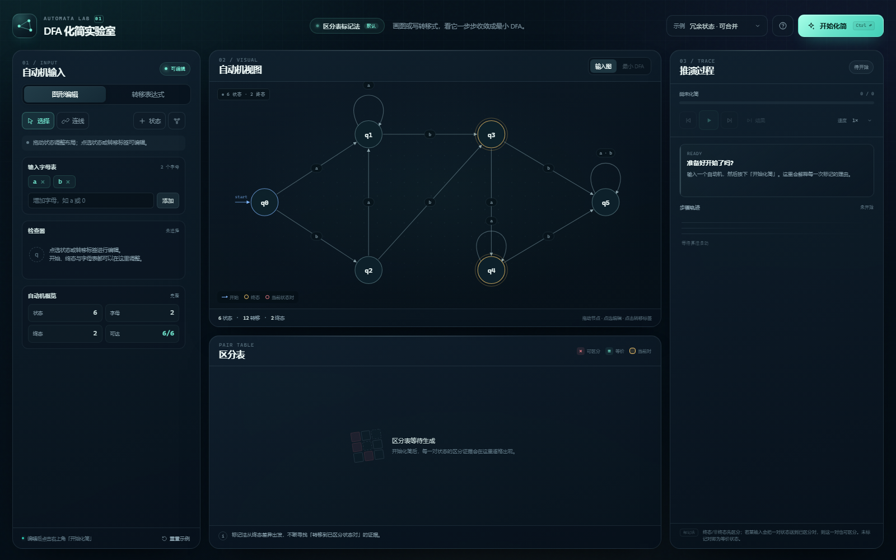
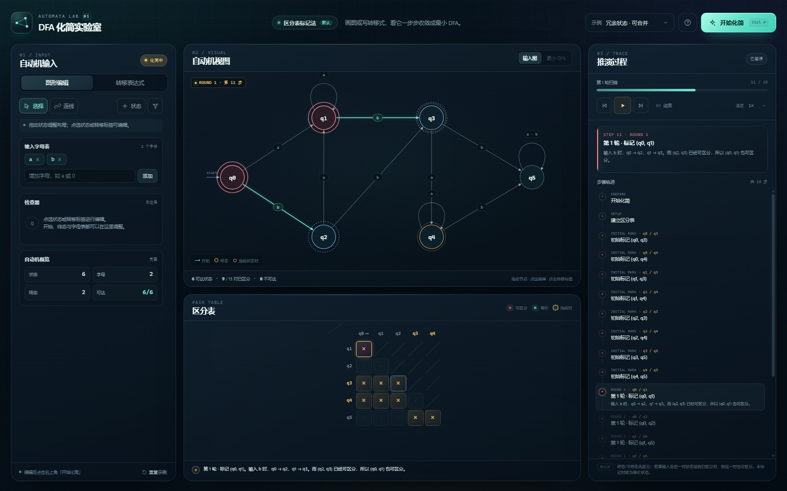
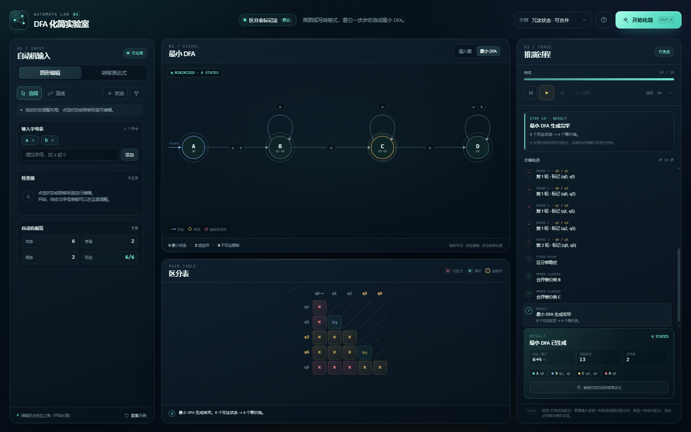

# DFA 化简实验室

一个纯前端、无依赖的 DFA 最小化互动工具。支持**直接编辑状态图**或**粘贴转移表达式**，按下化简后以「区分表标记法」逐步演示状态对如何被区分、等价状态如何合并，并生成最小 DFA。



## 快速开始

直接双击 **`index.html`**，用现代浏览器打开即可。页面不需要构建，也不需要联网或启动服务器。

```text
index.html     页面结构
styles.css     视觉样式与响应式布局
js/core.js     DSL 解析、DFA 预处理、标记法与步骤生成
js/app.js      图形编辑器、动画、播放器和所有界面交互
tests/         纯算法测试（Node）
```

运行核心测试：

```bash
node tests/core.test.js
# 或
npm test
```

## 两种输入方式

### 1. 图形编辑

- **选择工具**：拖动状态调整布局；点选状态可改名、设为开始状态、切换终态或删除。
- **连线工具**：点击起点，再点击终点，在弹窗中选择输入字母。点击同一个状态两次可以创建自环。
- **字母表**：在左侧添加或移除输入字母。移除正在被使用的字母时会先确认。
- **转移标签**：点击图中的转移标签，可以查看或删除该转移，或给这对状态补充别的字母。
- 右上角「状态」按钮添加新状态；布局按钮自动整理节点位置。

### 2. 转移表达式

切换到「转移表达式」页签，粘贴文本后点击 **应用表达式到图形**。按 `Ctrl + Enter` 会直接应用当前表达式并开始化简。

```text
states: q0, q1, q2
alphabet: a, b
start: q0
finals: q2

q0 -a-> q1
q0 -b-> q0
q1 -a,b-> q2
q2 -a-> q2
q2 -b-> q2
```

语法说明：

- 标题字段：`states`、`alphabet`、`start`、`finals`，支持中文冒号/逗号，也支持 `states：q0，q1` 这类全角标点。
- `states` 和 `alphabet` 可以省略，解析器会从开始状态、终态和转移中推断。
- 转移的推荐写法是 `起点 -字母-> 终点`；也支持 `q0 a q1`。
- 一行可声明多个字母，例如 `q1 -a,b-> q2`，也支持 `|`、`、` 分隔。
- `#` 或 `//` 开头的行是注释。终态为空时写 `finals: ∅` 或 `finals: 无`。
- 状态名允许文字、数字、下划线、点和间隔号；不允许空格，以及逗号、冒号、竖线、连字符等语法字符。
- 一个 DFA 最多 **20 个状态、10 个输入字母**。

## 化简动画怎么读

默认算法固定为**区分表标记法**（table-filling / marking algorithm）：

1. 先移除不可达状态；若 DFA 不完整，自动补一个陷阱状态（`sink`）。
2. 将可达状态两两配对，建立三角形区分表。
3. 终态与非终态一定可区分，立即标记。
4. 反复扫描未标记对：若某个输入字母会把当前对送到一个「已标记对」，就把当前对也标记。
5. 当一轮扫描没有任何新标记时，剩下的未标记对就是等价状态。
6. 合并等价类，得到唯一的最小 DFA。

界面里：

- **红色光晕**：当前正在判断的状态对。
- **蓝色虚线圈 / 蓝框表格单元**：导致这次判断的「证据状态对」。
- **表格中的 ×**：可区分；**≡ + 等价类字母**：等价，将合并。
- **播放条**：播放/暂停、上一步、下一步、直接跳到结果；速度支持 0.6×–3×。
- 结果视图会把等价类命名为 A/B/C…，并在节点内标出该等价类由哪些原状态组成。





### 缺失转移与不可达状态

- 不完整的 DFA 会在化简前自动补一个对所有字母自环的 `sink` 状态，过程日志和结果卡都会标注。
- 从开始状态不可达的状态会显示为半透明，并在化简前被移除；它们不会出现在区分表中。
- 同一份输入结果的统计使用「可达状态（含补全的 sink）→ 最小状态」展示，避免补全后看起来像状态变多。

## 快捷键

| 快捷键 | 功能 |
| --- | --- |
| `Ctrl` / `Cmd` + `Enter` | 开始化简（表达式页会先自动应用当前文本） |
| `Space` | 播放 / 暂停 |
| `←` / `→` | 上一步 / 下一步 |
| `Esc` | 退出连线模式 / 取消选择 / 关闭弹窗 |

## 输入限制与说明

- 只处理 **DFA**，不支持 NFA 或 ε 转移。
- 完整化时自动补的 sink 会参与最小化，因此某些缺边自动机在结果中会出现一个额外陷阱状态。
- 未实现 Hopcroft / Moore 等其他算法；本工具聚焦标记法的逐步可视化。
- 页面完全本地运行，不上传自动机数据，也没有第三方脚本或字体依赖。

## 开发说明

结构刻意保持轻量：

- `core.js` 可以在 Node 中直接 `require`，包含所有解析、完整化、标记法步骤、等价类、最小 DFA 和 DSL 格式化逻辑。
- `app.js` 负责图形布局、SVG 绘制、拖拽、动画帧与页面状态。
- 测试使用线性同余随机 DFA，与朴素不动点算法交叉验证区分对，并覆盖解析、推断、陷阱补全、不可达状态、空字母表、单项状态等边界。

浏览器要求：支持 ES2018+、`<dialog>`、`ResizeObserver` 和 `showModal()` 的现代浏览器（Edge / Chrome / Firefox / Safari 近期版本）。
